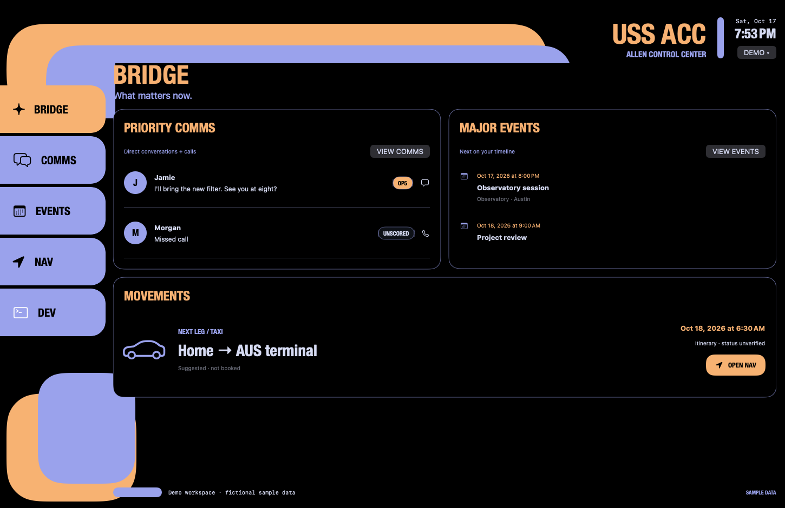

# USS ACC — Allen Control Center

A native macOS LCARS command center for **BRIDGE / COMMS / EVENTS / NAV / DEV**.



## Build and run

Requires a current Swift toolchain / Xcode 26 or newer. The base app targets macOS 14+; on-device Apple Intelligence classification requires macOS 26+ and an available Apple Intelligence model.

```sh
swift test
./scripts/build-app.sh
open 'build/USS ACC.app'
```

Open `Package.swift` in Xcode for development. Launch the packaged `.app` for Calendar, Automation and notification permissions: its Info.plist includes the privacy descriptions. `scripts/build-app.sh debug` packages a faster development build. The bundle is ad-hoc signed for local use, not notarized for distribution. The terminal requires a non-sandboxed app.

## Workspaces

- **Bridge:** priority communications, major upcoming events, and the next travel leg. Each opens its full workspace.
- **Comms:** unified person/address-based timeline for email, messages, and call activity. OP badges, explanations, manual score corrections, search, quarantine review, and a shared system composer. Demo data demonstrates all channels. Live incoming mail supports **Gmail, iCloud, Yahoo, Fastmail and any IMAP server over TLS**, plus **Apple Mail** automation; accounts can be **imported from Apple Mail** (server settings only — enter an app password for each). Messages and calls use **explicit system handoff**, not an undocumented Messages database or inline live call API.
- **Events:** seven-day schedule and event detail. Opt-in EventKit reads the next 60 days, including invitations delivered to your system calendars. Refresh is explicit.
- **Nav:** Apple Maps place search, directions handoff, and editable persistent journey legs for air, taxi, train, boat, road, and walking. Calendar import detects travel candidates by word-boundary keywords and requires review of endpoints/time zones; it does not parse tickets, book travel, or verify flight status. Reviewed legs are preserved when importing again. No live routing/flight reservation service is connected.
- **Dev:** interactive PTY terminal with multiple persistent sessions and project-folder selection, powered by [SwiftTerm](https://github.com/migueldeicaza/SwiftTerm). Sessions start only after New Session/Open Folder. Settings covers general mode, service connections, the spam filter, and notifications.

Switch stations with **⌘1–⌘5**. Open Settings with **⌘,**. The upper-right Demo/Live control separates fictional content from your accounts. Live connections are opt-in. On launch USS ACC reopens the last workspace and reconnects only the sources you previously connected; nothing new is requested.

## Operational Importance filter

The central COMMS filter uses Apple's on-device [Foundation Models](https://developer.apple.com/documentation/foundationmodels/systemlanguagemodel) framework and guided generation. No cloud fallback is configured.

| Level | Meaning |
| --- | --- |
| OP5 | Known person speaking directly to you / asking you a direct question. Always kept. |
| OP4 | Reserved; definition not configured. |
| OP3 | Reserved; definition not configured. |
| OP2 | Other content, unless a lower-level rule applies. |
| OP1 | Routine/informational notices, including late or needs-attention updates. |

Under **Dev → Settings → Spam Filter**, enter exact known sender addresses, enable incoming classification, and save per-level actions. Each level has a disposition (Keep / local Quarantine / Apple Mail Trash) and independent Highlight / Push controls. Rules initially keep everything; automatic deletion is off. Unscored, invalid, or unavailable-model results are kept visible. Automatic OP5 requires an exact configured sender address, not the display name; this is contact matching, not cryptographic sender authentication.

## Mail accounts

Add accounts under **Dev → Settings → Connections**: *Add Gmail*, *Add IMAP account*, or *Import from Apple Mail*. IMAP uses implicit TLS (port 993) with system certificate validation; plaintext/STARTTLS on 143 is rejected. Passwords are stored in the login Keychain (service `USS ACC Mail`), never in JSON. Gmail and iCloud require an app password (Gmail: 2-Step Verification → App passwords, with IMAP enabled; iCloud: account.apple.com → App-Specific Passwords). Mail never exposes passwords to automation, so imported accounts ask for one. POP and Exchange accounts are not imported. OAuth sign-in is not implemented yet. Each poll reads the newest 40 Inbox messages with `BODY.PEEK` (nothing is marked read). Delete moves the message to the account's special-use Trash (`UID MOVE`, or copy + `\Deleted` without expunge); if no Trash folder exists the message is kept. A changed `UIDVALIDITY` re-baselines the account.

Every mail source (Apple Mail, or each IMAP account) establishes its own inbox baseline **without applying destructive rules or notifications to existing items**. Subsequent arrivals are polled every 60 seconds while the app runs, up to 40 inbox messages per poll. This is not a background mail daemon: larger bursts or items moved out of the inbox between polls can be missed. Manual classification tests do not apply dispositions. Saving policy does not retroactively process old messages. Reconnect uses a durable seen-ID ledger to avoid replaying old arrivals. Local quarantine is specific to USS ACC, not a Mail server folder. Delete invokes Apple Mail's delete action (normally moves to Trash under Mail/account settings); it never requests permanent expunge. Test provider behavior before enabling deletion rules.

Call scoring is limited to data a future call/voicemail adapter can supply. The app does not record calls or pretend to know live speech before it happens.

## Local data

`~/Library/Application Support/USSACC/` contains atomically written, user-readable-only JSON files:

- `policy.json`: saved rules and known sender addresses.
- `journeys.json`: manually added/reviewed live itinerary legs.
- `intake.json`: seen mail IDs, per-source baselines, local quarantine IDs and classification metadata/reasons.
- `accounts.json`: IMAP account settings (no passwords).
- `preferences.json`: last workspace (Demo/Live) and whether Apple Mail and Calendar were connected; restored on launch.

Message bodies remain in memory, not on disk. Calendar data is read on demand. Native map queries go to Apple Maps. Shell commands run locally with your user permissions. Model input includes a truncated subject/body to fit its context window; classification is best-effort, not proof that a message is spam or safe. Notifications contain sender and OP level, not the message body.

## Validation and design

See [validation results](docs/VALIDATION.md) and [actual app screenshots](docs/screenshots/).

`swift test` exercises policy invariants, known-address matching, reserved/unscored handling, arrival baseline/replay protection, local persistence, and calendar travel import/review semantics. The macOS GitHub Actions workflow runs tests and packages an app artifact. Approved mockups and the multimodal/filter design notes are in [`docs/design`](docs/design/). Mockup terminal output and journeys are fictional; they are not validation logs.

Next integration work: first-class message and call providers, provider-native quarantine folders, richer calendar editing/reminders, ticket extraction and status feeds, outgoing in-app send flows, and user-configurable OP3/OP4 definitions.
